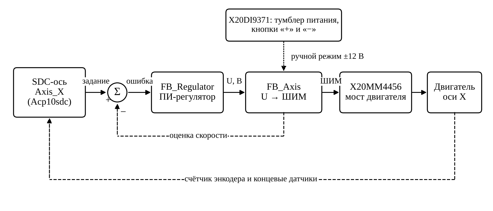
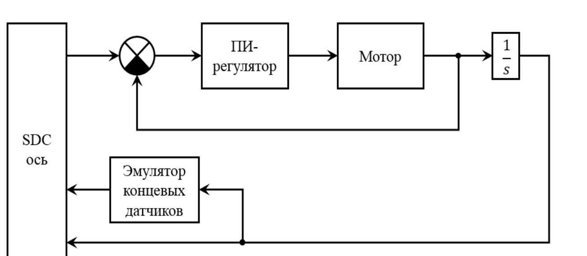
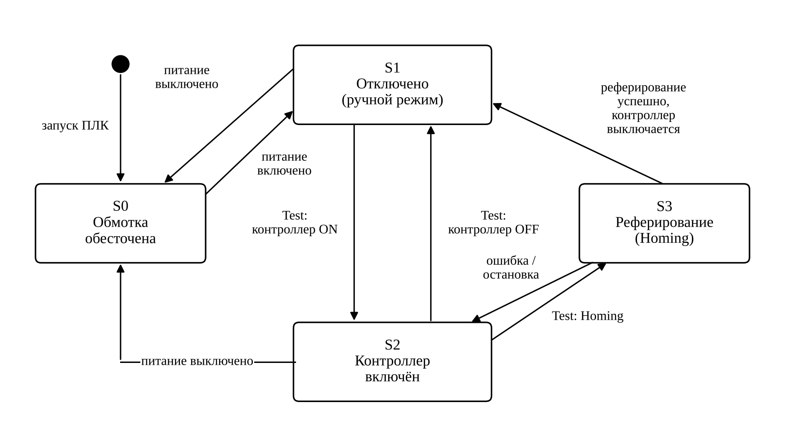
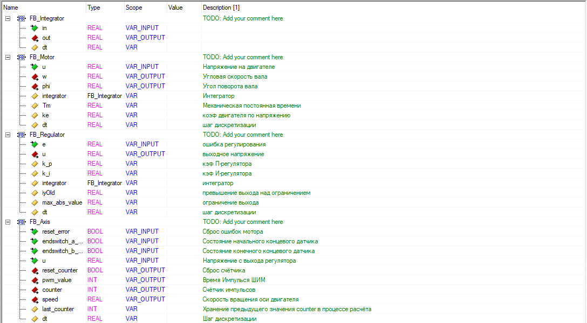
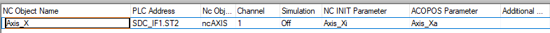
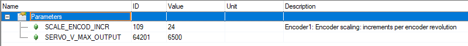
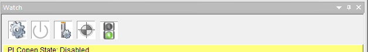
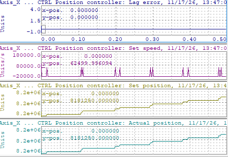

<div align="center">

# 🤖 Управление одной осью робота УРТК (SDC-ось)

**Лабораторная работа №3 · «Программное обеспечение мехатронных и робототехнических систем»**

B&R Automation Studio 4.5.2 · ANSI C · ACP10 / Acp10sdc · ПИ-регулятор · NC Trace



<sub>Структура системы управления осью X: SDC-ось → ПИ-регулятор → ШИМ → двигатель постоянного тока</sub>

</div>

---

## 📑 Содержание

1. [О проекте](#about)
2. [Задание](#task)
3. [Стенд и оборудование](#stand)
4. [Как это работает](#how)
5. [Конечный автомат оси](#fsm)
6. [Функциональные блоки](#blocks)
7. [Настройка оси](#axis)
8. [Мэппинг](#mapping)
9. [Как повторить работу](#howto)
10. [Результаты эксперимента](#results)
11. [Структура репозитория](#structure)

---

<a id="about"></a>

## 🎯 О проекте

Двигатель постоянного тока оси X учебного робота **УРТК** подключён к системе управления движением B&R **ACP10** как **SDC-ось** (Smart Device Controller). Для Automation Studio она выглядит как обычная ось ACOPOS: её можно включать, реферировать и записывать графики из окна **Test** и средством **NC Trace**. Обмен с железом делает прикладная программа: передаёт оси показания энкодера и концевиков, получает задание скорости и сама формирует ШИМ на двигатель.

Регулятор скорости и интегратор взяты из лабораторной работы №1 (библиотека `MotorContr`), для оси добавлен новый блок `FB_Axis`.

<a id="task"></a>

## 📝 Задание

> Создать функциональный блок на основе библиотеки **Acp10sdc**, который управляет одной осью УРТК. Обработать концевые датчики, выполнить реферирование к датчику со стороны мотора (после реферирования ось переходит в состояние «отключено»). Управление из окна Test или с кнопок стенда. Цикл программы 2 мс.



<a id="stand"></a>

## 🔧 Стенд и оборудование

| Модуль | Назначение |
|---|---|
| **4PP065_0571_P74** | ПЛК с панелью оператора |
| **X20BC0083** | Контроллер шины X2X |
| **X20MM4456** | Мост двигателя постоянного тока: ШИМ, счётчик энкодера, входы концевиков |
| **X20DI9371** | Цифровые входы: тумблер питания обмотки, кнопки «+» и «−» |
| Двигатель оси X | Двигатель постоянного тока с инкрементным энкодером (24 имп/об) |

Библиотеки проекта: `Acp10sdc`, `Acp10man`, `Acp10par`, `Acp10_MC`, `AsIOTime`.

<a id="how"></a>

## ⚙️ Как это работает

Программа `SDCAxisCtrlX` выполняется каждые **2 мс**:

1. **Питание обмотки.** По тумблеру на канал обмотки подаётся ШИМ 32767 или 0.
2. **Обслуживание SDC-оси.** Увеличиваются счётчики жизни (`iLifeCnt…`), передаются время цикла (`AsIOTimeCyclicStart`), счётчик энкодера и концевики. Готовность привода = положение тумблера.
3. **Реферирование.** Когда ось успешно выходит из Homing, программа выключает регулятор (`ncSWITCH_OFF`), и ось переходит в «отключено».
4. **Регулятор скорости.** Задание оси переводится в unit/с, сравнивается с оценкой скорости, ПИ-регулятор выдаёт напряжение.
5. **Ручной режим.** При выключенном регуляторе кнопки дают ±12 В, движение блокируется концевиком.
6. **ШИМ.** `FB_Axis` переводит напряжение в ШИМ; меньше 4 В по модулю → ШИМ 0 (двигатель не трогается).

Основные формулы:

$$v_з = N_з \cdot \frac{V_{max}}{32767}, \qquad e = v_з - v$$

$$u = \mathrm{sat}\left(k_п e + \int \Big(k_и e - \frac{\Delta}{T_ц}\Big)dt\right), \qquad P = \frac{u}{U_{max}} \cdot 32767, \qquad v = \frac{u}{U_{max}} \cdot V_{max}$$

где $V_{max} = 6500$ unit/с, $U_{max} = 24$ В, $T_ц = 0{,}002$ с, $\Delta$ — превышение выхода регулятора над ограничением (anti-windup).

Цена одного импульса энкодера:

$$q = \frac{3000\ \text{unit/об}}{24\ \text{имп/об}} = 125\ \text{unit}$$

<a id="fsm"></a>

## 🚦 Конечный автомат оси



| Состояние | Что происходит | Кнопки «+» / «−» |
|---|---|---|
| **S0** Обмотка обесточена | Тумблер выключен, напряжение 0 | не действуют |
| **S1** Отключено | Регулятор выключен, ручной режим ±12 В | действуют, стоп по концевику |
| **S2** Регулятор включён | SDC-ось задаёт скорость, ПИ-регулятор до ±24 В | заблокированы |
| **S3** Реферирование | Движение к концевику со стороны мотора (6000 → 2000 unit/с) | заблокированы |

После успешного Homing ось сама возвращается в **S1** — это требование задания.

<a id="blocks"></a>

## 📦 Функциональные блоки



| Блок | Назначение |
|---|---|
| `FB_Integrator` | Интегратор методом Эйлера |
| `FB_Regulator` | ПИ-регулятор с ограничением выхода и защитой от насыщения |
| `FB_Axis` | Напряжение → ШИМ для X20MM4456, оценка скорости оси |
| `FB_Motor` | Модель двигателя из ЛР1 (на стенде не вызывается) |

Константы регулятора: шаг 0,002 с, ограничение 24 В, `k_i = 0.16`, `k_p = 0` (на стенде регулятор работает как интегральный).

<a id="axis"></a>

## 🧭 Настройка оси

**NC-мэппинг (`Acp10map.ncm`):**



| NC Object | PLC Address | Тип | Init | ACOPOS Parameter |
|---|---|---|---|---|
| `Axis_X` | `SDC_IF1.ST2` | `ncAXIS` | `Axis_Xi` | `Axis_Xa` |

**Таблица ACOPOS (`Axis_Xa`):**



| Параметр | ID | Значение |
|---|---|---|
| `SERVO_V_MAX_OUTPUT` | 64201 | 6500 unit/с |
| `SCALE_ENCOD_INCR` | 109 | 24 имп/об |

**Параметры инициализации (`Axis_Xi`):** `units = 3000`, `kv = 10`, `a = 10000`, `ds_stop = 50000`, `ds_warning = 500`, `v_switch = 6000`, `v_trigger = 2000`, `mode = ncEND_SWITCH`, `edge_sw = trigg_dir = ncNEGATIVE`, концевики `ncACTIV_HI`.

<a id="mapping"></a>

## 🔌 Мэппинг

**X20MM4456**

| Канал | Переменная |
|---|---|
| PeriodDurationPWM | `pwm_period` |
| PulseWidthCurrentPWM01 | `axis_X.pwm_value` |
| ClearError01 | `axis_X.reset_error` |
| ResetCounter01 | `axis_X.reset_counter` |
| Counter01 | `axis_X.counter` |
| StatusInput03 | `axis_X.endswitch_a_reached` |
| StatusInput04 | `axis_X.endswitch_b_reached` |
| PulseWidthCurrentPWM04 | `coil_pwm_value` |

**X20DI9371**

| Канал | Переменная |
|---|---|
| DigitalInput01 | `coil_powered` — тумблер питания обмотки |
| DigitalInput02 | `pos_hand_btn` — кнопка «+» |
| DigitalInput03 | `neg_hand_btn` — кнопка «−» |

<a id="howto"></a>

## ▶️ Как повторить работу

1. Добавить библиотеки `Acp10*` и **`AsIOTime`** (без неё не соберётся `AsIOTimeCyclicStart`).
2. Создать глобальные переменные оси: `Axis_X`, `Axis_X_HW`, `Axis_X_DrvIf`, `Axis_X_DiDoIf`, `Axis_X_EncIf`.
3. Добавить `ACP10 Axis` (`Axis_Xi`) и `ACOPOS Parameter Table` (`Axis_Xa`), заполнить по разделу [Настройка оси](#axis).
4. В Configuration View → Motion добавить `ACP10 NC Mapping Table`, строку оси `Axis_X` → `SDC_IF1.ST2`.
5. Скопировать библиотеку `MotorContr` из ЛР1, добавить блок `FB_Axis` (код в [`code/`](code/Logical)).
6. Создать программу `SDCAxisCtrlX` (ANSI C) в классе задач **2 мс**, выполнить мэппинг.
7. Build → Transfer. Включить тумблер питания.
8. `Acp10map.ncm` → правый клик по `Axis_X` → **Test → Parallel Mode** → инициализация → контроллер ON → **Homing**.
9. Записать графики средством **NC Trace**: ParID 111, 112, 113, 114.

<a id="results"></a>

## 📊 Результаты эксперимента

**Состояние оси в Watch:** регулятор выключен (Disabled), ошибок нет.



**NC Trace оси X:**



| ParID | Величина | Что видно |
|---|---|---|
| 111 | Set position | растёт ступенями |
| 113 | Actual position | совпадает с заданной |
| 112 | Lag error | равна 0 на всём интервале |
| 114 | Set speed | короткие пики ≈ 62 500 unit/с |

Ступени позиции — это дискретность энкодера: один импульс = 125 unit. Если за цикл 2 мс пришёл один импульс, скорость по разности позиций равна

$$v_q = \frac{125}{0{,}002} = 62\,500\ \text{unit/с}$$

— ровно высота пиков на графике заданной скорости.

| Проверка | Результат |
|---|---|
| Компиляция и загрузка | ✅ без ошибок, RUN |
| Инициализация и включение регулятора в Test | ✅ ошибок нет |
| Homing по датчику со стороны мотора, затем «отключено» | ✅ |
| Ручное движение кнопками | ✅ в обе стороны |
| NC Trace | ✅ заданная и фактическая позиция совпадают |

<a id="structure"></a>

## 📁 Структура репозитория

```
lab3-urtk-sdc-axis/
├── README.md
├── code/
│   └── Logical/
│       ├── SDCAxisCtrlX/
│       │   └── Main.c                 # программа управления осью X
│       └── Libraries/MotorContr/
│           ├── FB_Axis.c              # напряжение → ШИМ, оценка скорости
│           ├── FB_Regulator.c         # ПИ-регулятор с anti-windup
│           ├── FB_Integrator.c        # интегратор (Эйлер)
│           └── FB_Motor.c             # модель двигателя из ЛР1
└── docs/
    ├── images/                        # схемы и скриншоты
    └── Лабораторная_работа_3_Ось_УРТК_КРБО-02-23.docx
```

---

<div align="center">
<sub>РТУ МИРЭА · Институт искусственного интеллекта · Кафедра проблем управления · КРБО-02-23 · 2026</sub>
</div>
